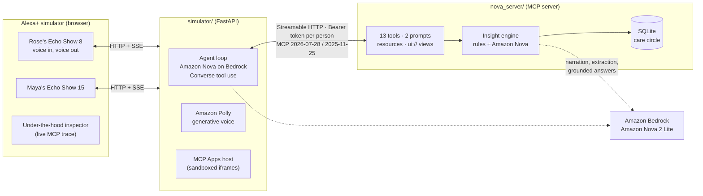

# Nova · a care circle for Alexa+

**Nova lets an older adult living alone, and the family who worry about them, share one voice-first care circle on Alexa+.**
Rose tells her kitchen Echo how she feels and which pills she took. Her daughter, two thousand miles away, asks her own Echo *"How's Mom doing?"* and hears what matters, with the evidence on screen and a next step.

Nova is a self-hosted **MCP server** (Streamable HTTP, MCP spec 2025-11-25 and 2026-07-28), the integration path Alexa+ uses for third-party experiences. The repo also ships a **simulated Alexa+** (two Echo Show devices in a browser) whose agent runs on **Amazon Nova models in Amazon Bedrock**.

> Track: **Alexa+** (self-hosted MCP server + simulated Alexa+ experience) · Mini challenge: **AWS Builder** (Amazon Bedrock with Amazon Nova, Amazon Polly)

---

## Why

- More than 53 million Americans are unpaid family caregivers (AARP, *Caregiving in the U.S.*, 2020), many of them long-distance.
- About one in four adults 65+ falls each year (CDC).
- The early signals are small and scattered: a skipped evening pill, "I felt a bit woozy getting up", an aide's note about blood pressure. Nobody sees them together until something goes wrong.

Voice is the right interface: no app to learn, no screen to unlock, and Alexa is already in the kitchen.

## What Nova does

**For Rose (the person being cared for), on her Echo Show 8**
- *"I just took my pink pill"*: logs it by how it looks, what it's for or its name. **Double-dose guard**: *"You already took Lisinopril at 8:14 AM, so please don't take another one."*
- *"I'm a bit dizzy this morning and my knee hurts"*: a daily check-in in her own words. Amazon Nova extracts mood, pain, sleep and symptoms.
- **Consent first**: *"Would you like me to let Maya and Leo know you're feeling dizzy?"* (an MCP elicitation). Rose decides. Emergencies (a fall, chest pain) skip the question and alert everyone.
- *"Can I take ibuprofen for my knee?"*: answers **only from what her doctors wrote** and cites the note.
- *"Stop sharing my medications with the family"*: Rose controls what her circle sees.

**For Maya (her daughter), on her Echo Show 15**
- *"How's Mom doing?"*: a spoken briefing plus an on-screen card (MCP Apps). Nova **connects the dots**:
  > *Dizziness began after her lisinopril change. Rose has mentioned dizziness 4 times since Oct 15, two days after Dr. Patel raised it from 10 mg to 20 mg. Grace measured a sitting BP of 104/62. Dr. Patel's notes say to call about dizziness (614-555-0190).*
- **Evening doses slipping** while mornings hold, mood and pain trends, *"she's stopped her walks"*, all with evidence.
- *"Prepare a brief for Mom's cardiology visit"*: a one-page doctor-visit brief with adherence, symptoms with first-seen dates, and specific questions to ask.
- Open alerts she can mark handled from the screen, and messages to and from Mom.

Nova never diagnoses. It notices patterns, shows its evidence, quotes the care team, and suggests who to call.

## Architecture



| Layer | What it is |
|---|---|
| `nova_server/` | The Alexa+ integration: an MCP server built on the official Python SDK (`mcp` 2.3). Streamable HTTP at `/mcp`. |
| `simulator/` | A simulated Alexa+: two Echo devices, each with its own MCP session and bearer token, an Amazon Nova tool-use agent, an MCP Apps host and a live protocol inspector. |
| `skills/nova-care/` | An Agent Skill that teaches any agent (Claude Code, Kiro, Alexa+ Agent Skills) how to run Nova conversations well. |

### MCP features used
- **Streamable HTTP** transport; negotiates **2026-07-28** (and supports 2025-11-25 clients, which is what Alexa+ speaks today).
- **Identity per person** from the bearer token (`TokenVerifier`), with **OAuth 2.0 Protected Resource Metadata** (RFC 9728) at `/.well-known/oauth-protected-resource/mcp`. The same tool answers differently for Rose and Maya. In production the token comes from Alexa+ account linking.
- **Structured output** with an `outputSchema` on every tool; each result carries a `speech` line written for TTS.
- **Tool annotations** (`readOnlyHint`, `destructiveHint`, `idempotentHint`, `openWorldHint`) and **icons**.
- **MCP Apps** (`io.modelcontextprotocol/ui`): `get_today`, `care_briefing` and `prepare_visit` link to `ui://nova/*.html` views (`text/html;profile=mcp-app`) that render on the Echo Show screens and can call tools back through the host (e.g. *Mark taken*, *Mark handled*).
- **Elicitation** for consent, via SDK resolvers: an `InputRequiredResult` round trip on 2026-07-28, or `elicitation/create` on 2025-11-25. The consent parameter never appears in the model-visible schema.
- **Resources** (`nova://circle`, `nova://timeline`) and **prompts** (`morning_checkin`, `caregiver_briefing`).

### Tools

| Tool | Who | What |
|---|---|---|
| `get_today` (UI) | both | Today's doses (taken/due/missed/upcoming), appointments, unread messages |
| `log_medication` | both | Log by name, purpose or appearance; double-dose guard |
| `check_medication` | both | "Did I take…", "what's the pink pill for?" |
| `daily_checkin` | Rose | Free-form check-in → structured signals, red flags, consent |
| `send_message` / `read_messages` | both | Circle messaging |
| `ask_care_notes` | both | Grounded answers from doctors' notes, with sources |
| `get_help` | Rose | Alert the whole circle now |
| `care_briefing` (UI) | family | Status, adherence, trends, insights with evidence, alerts |
| `prepare_visit` (UI) | both | Doctor-visit brief with questions to ask |
| `list_alerts` / `resolve_alert` | family | Open alerts, mark handled with a note |
| `set_sharing` | Rose | Privacy: what the circle can see |

### How Amazon Nova is used (AWS Builder)
- **Simulated Alexa+ brain**: `simulator/agent.py` runs the tool-use loop with the **Bedrock Converse API** and Amazon Nova (default `*.amazon.nova-2-lite-v1:0`, auto-selected by region, falls back through Nova Lite and Micro).
- **Inside the MCP server** (`nova_server/insights.py`): Amazon Nova turns detected patterns into a warm spoken briefing, extracts structure from free-form check-ins, answers questions grounded only in the care notes, and drafts doctor-visit briefs.
- **Amazon Polly** (generative voice) speaks replies in the simulator.
- **Design choice:** pattern detection is deterministic and evidence-backed; the model writes the language. Every model call has a template fallback, so Nova degrades to a rules engine (or a local Ollama model) instead of failing.

## Run it

Requires Python 3.12+ and [uv](https://docs.astral.sh/uv/).

```bash
git clone https://github.com/Dakshhhhh-ops/nova && cd nova
uv sync
cp .env.example .env        # optional: AWS_REGION, NOVA_LLM, NOVA_MODEL_ID

# one command: MCP server + simulator, opens the browser
uv run python run.py

# or separately
# terminal 1: the MCP server (http://127.0.0.1:8765/mcp)
uv run python -m nova_server

# terminal 2: the Alexa+ simulator (http://127.0.0.1:8080)
uv run python -m simulator
```

Open http://127.0.0.1:8080 in Chrome (for the microphone). Use the suggestion chips or talk. **Reset demo** re-seeds the household relative to the current time.

**Which brain?** `NOVA_LLM=auto` (default) uses Amazon Bedrock if your AWS credentials work and Amazon Nova is enabled in the region; otherwise a local Ollama model (`OLLAMA_MODEL`, default `qwen3:8b`); otherwise a deterministic offline router. The active brain is shown in the top bar.

### Connect other MCP clients
- **MCP Inspector**: `npx @modelcontextprotocol/inspector`, URL `http://127.0.0.1:8765/mcp`, header `Authorization: Bearer nova-demo-maya` (or `nova-demo-rose`, `nova-demo-leo`, `nova-demo-grace`).
- **stdio** (Claude Desktop, Kiro, Claude Code): `uv run python -m nova_server --stdio --as rose`.

### Tests
```bash
uv run pytest -q
```
Covers the double-dose guard, the dizziness-after-dose-change insight (including corroboration and the cited instruction), privacy rules, grounded answers, red flags, and a real Streamable HTTP round trip with bearer auth and a consent elicitation.

## Safety and privacy
- **No diagnosis, no new medical advice.** Answers about medications and symptoms come from the care team's own notes, with sources.
- **The older adult is in charge.** Consent before sharing symptoms; per-category sharing that only she can change; caregivers see a respectful "Rose has chosen not to share…" instead of data.
- **Emergencies are not gated.** Falls, chest pain, breathing trouble and stroke signs alert the whole circle immediately and tell her to call 911.
- **Identity comes from the token**, never from what someone says.
- The demo household is fictional.

## Roadmap
- Production account linking (Login with Amazon / Amazon Cognito) and deployment on Amazon Bedrock AgentCore Runtime.
- **Ring**: "Rose hasn't opened the front door today" as a gentle signal; caregiver video check-in with consent.
- **Fire TV**: an ambient care card for the family room.
- Pharmacy refill reminders and pill-organizer photo check with Amazon Nova multimodal.

## License
MIT. See [LICENSE](LICENSE).
