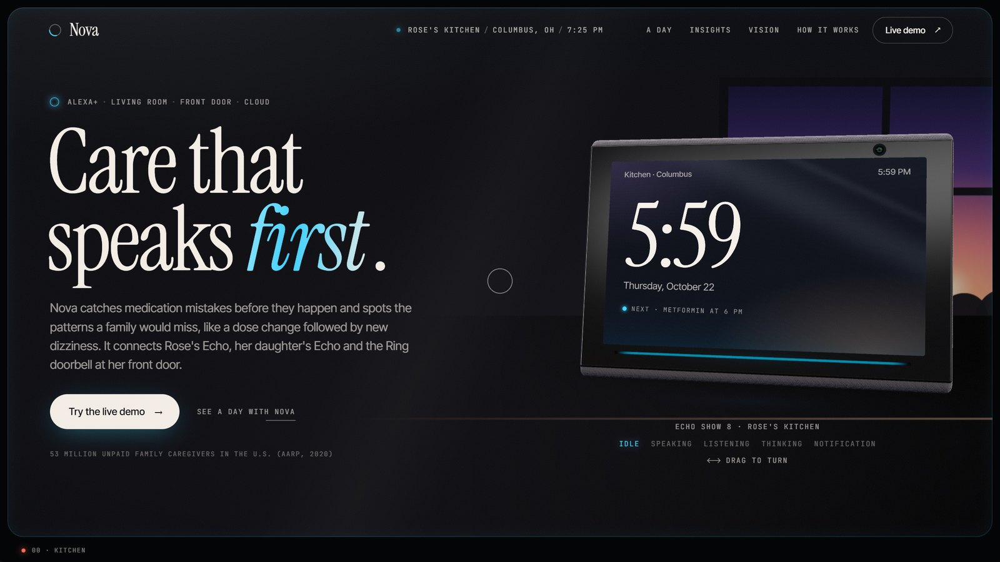
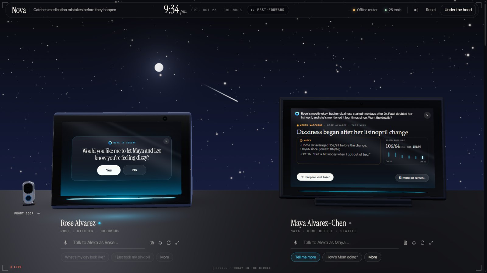
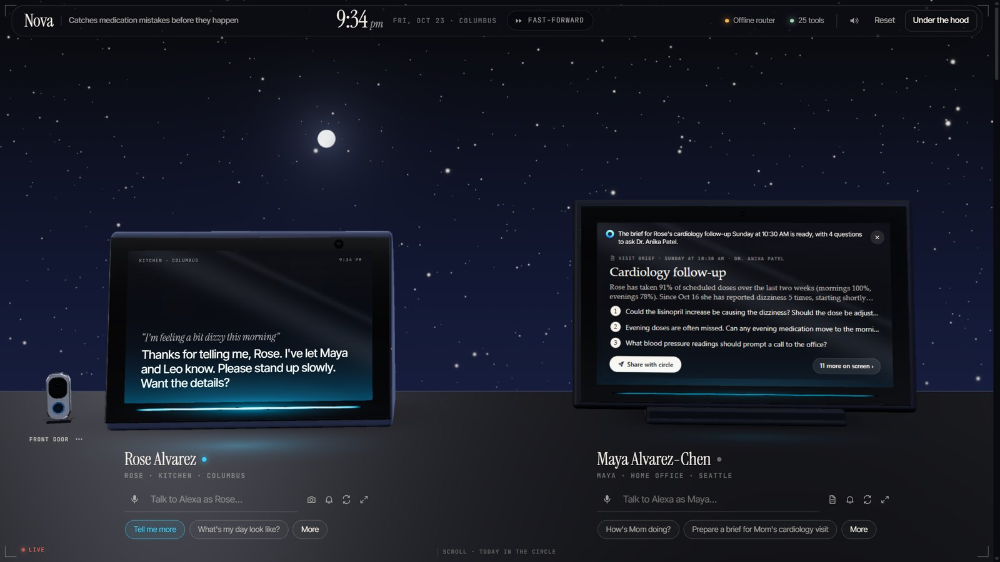
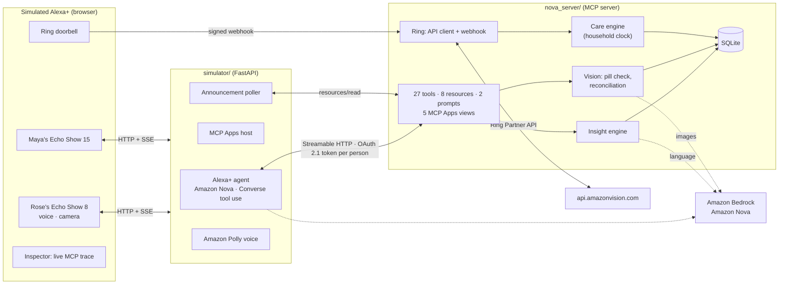
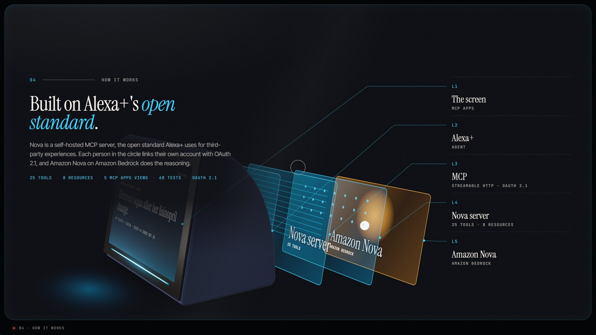

<div align="center">

# Nova

**Medication safety and care coordination for Alexa+**

Nova catches medication mistakes before they happen and connects the signals a family would miss,<br/>
for an older adult who lives alone and the people who care for her.

[](https://github.com/Dakshhhhh-ops/nova/actions/workflows/ci.yml)
[](LICENSE)


[**Live demo**](https://nova-6kte.onrender.com/live) · [Story page](https://nova-6kte.onrender.com) · [Lite (no 3D)](https://nova-6kte.onrender.com/?flat=1) · [Architecture](docs/ARCHITECTURE.md) · [Submission notes](docs/SUBMISSION.md)

</div>



---

## Contents

- [Overview](#overview)
- [What Nova does](#what-nova-does)
- [Architecture](#architecture)
- [Integrations](#integrations)
- [Getting started](#getting-started)
- [Configuration](#configuration)
- [MCP reference](#mcp-reference)
- [Testing](#testing)
- [Security, privacy and compliance](#security-privacy-and-compliance)
- [Project structure](#project-structure)
- [Roadmap](#roadmap)
- [License](#license)

## Overview

More than 53 million Americans are unpaid family caregivers (AARP, *Caregiving in the U.S.*, 2020), many of them far from the person they look after. The risky moments are predictable: a new dose after a doctor's visit, an old bottle still in the cabinet, a missed evening pill. The early warning signs are small and scattered: "I felt a bit woozy getting up", an aide's blood pressure reading, a quiet morning. Nobody sees them together until something goes wrong.

Nova brings them together on the devices the household already uses. It connects three places on Alexa+:

| Place | Device | Role |
|---|---|---|
| **The living room** | Rose's Echo Show 8 | Reminders, pill checks, daily check-ins, consent |
| **The front door** | Rose's Ring doorbell; separate door sensor | Doorbell activity, expected visits to confirm, and door-opening signals |
| **The cloud** | Maya's Echo Show 15, and Nova | Briefings, escalations, plan changes, the visit brief |

Nova is a self-hosted **Model Context Protocol (MCP) server**, the open standard Alexa+ uses for third-party experiences. This repository also includes a **simulated Alexa+** (two Echo Shows and a Ring doorbell in the browser) whose agent runs on **Amazon Nova in Amazon Bedrock**, because Alexa+ developer preview access isn't generally available.

## What Nova does

**The main story: a prescription change, from paper to the pill bottle.** After a cardiology visit, Dr. Patel lowers Rose's lisinopril from 20 mg to 10 mg.

1. **Maya scans the new instructions.** She photographs the after-visit summary on her Echo Show. Amazon Nova reads it, and Nova reconciles it with Rose's plan: *change lisinopril 20 → 10 mg, because of dizziness when standing and low blood pressure*.
2. **She reviews and approves.** Nothing changes until she does.
3. **Rose hears the update.** Her Echo explains it in plain words: *"Rose, Dr. Patel changed your lisinopril from 20 mg once daily to 10 mg."*
4. **Rose shows the old bottle.** She holds her old 20 mg bottle up to the camera: *"Careful, Rose: this is the old 20 mg lisinopril. Your plan is now 10 mg, so please set this bottle aside."*
5. **Maya sees what happened and handles the follow-up.** Her Echo tells her, and one tap starts the new 10 mg refill: *"I've saved a simulated Lisinopril refill handoff. Please contact Elm Street Pharmacy to place the request."*

One sequence shows vision, state that persists, human approval, two identities from two tokens, voice and screen, and MCP. In the live demo, **Start the story** walks through it step by step.

Care follow-ups have an owner and a history: caregivers can claim an alert, record an action, and resolve it. Other caregivers see who is handling it. Existing databases migrate automatically, preserving their alerts.

Ring doorbell events never establish a visitor's identity. A scheduled visitor prompts a confirmation; the aide checklist and arrival notifications are sent only after someone confirms. Door-opening signals are labelled separately as door-sensor events.

Image cards disclose whether a model or a bundled sample fixture read the image. Label confidence is a heuristic, not measured accuracy, and a patient-name mismatch blocks approval. Pharmacy handoffs and their ready times are explicitly simulated; Nova does not send requests to a pharmacy.

**It speaks first.** A care engine runs on the household clock and turns the care plan into announcements on the right device.

| When | What happens |
|---|---|
| 6:00 PM, a dose is due | Rose's Echo: *"It's 6 PM, Rose. Time for your Metformin with your meal."* |
| 6:30 PM, not yet taken | A gentle follow-up on Rose's Echo |
| 7:30 PM, still not taken | Maya's Echo: *"Mom hasn't taken her 6 PM Metformin. I reminded her at 6 PM and 6:30 PM."* |
| 9:00 AM | The morning check-in: *"How are you feeling today?"* |
| 11:00 AM, a quiet home | No pills logged and no movement at the door: a wellness check, then an urgent alert to the family |
| A bottle running low | A refill nudge and simulated handoff; the family contacts the pharmacy |

**It sees.** Rose holds a bottle up to the Echo Show camera. Amazon Nova reads the label and Nova checks it against her plan: the right pill at the right time, a pill already taken, an outdated strength, or a medicine her doctor said to avoid (*"Please don't take ibuprofen, Rose…"*). Nova says *take it* only when it is sure: the exact product (not a combination or extended-release version), the strength read and matching the plan, and a confident read. Otherwise it asks her to check with the pharmacist, and it refuses outright when it can't read the label. Maya photographs an after-visit summary, and Nova proposes the plan changes (*change, start, stop, continue*, with the doctor's reasons). Nothing changes until she approves.

**It connects the dots, with evidence.** *"How's Mom doing?"* gets a one-sentence answer and a card that fits one screen:

> **Dizziness began after her lisinopril change.** Home BP averaged 152/91 before the change and 110/66 since. Rose has mentioned dizziness four times since Oct 15. Grace saw her unsteady. Dr. Patel's notes say to call about dizziness.

Insights come from deterministic, tested rules, and each one carries its evidence. Amazon Nova writes the words. Nova never diagnoses.

**It reads the front door.** Nova calls the **Ring Partner API** for the linked doorbell's status and event history, and takes Ring's signed webhooks in real time. A doorbell press near a scheduled visit prompts Rose to check who is there. Once she confirms the visitor, the aide gets her checklist and the family hears about the arrival.

**It stays respectful.** Spoken replies are one or two sentences, with the details one *"tell me more"* away. Rose is asked before her family hears about a symptom, and she decides what the circle can see. Emergencies skip every question.

### What we heard
We showed the demo to a friend and asked what's hardest and what worries them. Unedited:

> "The hardest part is making sure they take the right medicine at the right time, especially when they have multiple medicines throughout the day. Sometimes they forget whether they've already taken a dose, and family members can't always be around to check."
>
> "Yes, I think it could be helpful, especially for families who can't stay with their elderly parents all day. Automatic reminders and alerts for missed doses would provide peace of mind. My main concerns would be whether the camera can accurately identify the medicines, whether the system is easy for elderly people to use, and whether it protects their privacy. I'd also want to make sure it doesn't send false alerts or create confusion about whether a dose was actually taken."

| Their concern | What Nova does |
|---|---|
| Can the camera identify medicines accurately? | It says "take it" only for the exact product, with a readable strength that matches the plan and a confident read. Otherwise it says to check with the pharmacist, and it refuses unreadable labels. |
| Is it easy for elderly people to use? | Voice first, one or two sentences per reply, big on-screen answers, and "repeat that" works. |
| Does it protect their privacy? | The older adult decides what her family can see, and Nova asks her before sharing a symptom. |
| False alerts, or confusion about whether a dose was taken? | The family hears only after two reminders and 90 minutes. A double-dose guard answers *"you already took it at 8:14 AM."* |

One person's view, not a study; caregivers, nurses and pharmacists are next.

| Rose is asked before her family is told, while Maya sees the evidence | A doctor-visit brief, one request away |
|---|---|
|  |  |

## Architecture



| Component | Description |
|---|---|
| `nova_server/` | The Alexa+ integration. An MCP server on the official Python SDK (`mcp` 2.3) with Streamable HTTP at `/mcp`, an OAuth 2.1 authorization server, the care engine, the insight engine, vision, and the Ring Partner API client and webhook. |
| `simulator/` | A simulated Alexa+: two Echo Shows and a Ring doorbell. Each Echo has its own MCP session and per-person token, an agent loop on Amazon Nova, an MCP Apps host, live announcement delivery, and a protocol inspector. |
| `simulator/static/site/` | The story page, with Three.js scenes. |
| `samples/` | Demo images (prescription bottles, an over-the-counter bottle, an after-visit summary) and their generator. |
| `skills/nova-care/` | An Agent Skill that teaches agents how to run Nova conversations. |



Sequence diagrams for a voice turn, the escalation ladder, consent by elicitation, photo-to-plan reconciliation, account linking and the Ring integration are in [docs/ARCHITECTURE.md](docs/ARCHITECTURE.md).

## Integrations

### Alexa+ (Model Context Protocol)
- **Streamable HTTP**, negotiating MCP **2026-07-28** and serving **2025-11-25** clients.
- **Account linking with OAuth 2.1**: protected-resource metadata (RFC 9728), authorization-server metadata (RFC 8414), dynamic client registration (RFC 7591), PKCE, refresh-token rotation and revocation. Identity comes from the token, so the same tool answers differently for Rose and for Maya.
- **MCP Apps** (`io.modelcontextprotocol/ui`): five `ui://` views (today, briefing, visit brief, pill check, reconciliation) render on the Echo Show screens and call tools back through the host. Camera-only tools are hidden from the model with `_meta.ui.visibility: ["app"]`.
- **Elicitation** for consent, through SDK resolvers, and only when the client supports it.
- **Structured output** with an `outputSchema` on every tool, a short `speech` line for voice and `more` for *"tell me more"*.
- **Resources as a delivery queue**: `nova://announcements` is how Nova speaks first (proactive notifications on Alexa+).

### Amazon Nova on Amazon Bedrock
- **Agent loop** (`simulator/agent.py`): tool use through the Bedrock Converse API (Amazon Nova 2 Lite by default, with region-aware inference profiles and Nova Lite and Micro as fallbacks). When a tool returns a ready-to-speak line, the agent speaks it without a second model call.
- **Vision** (`nova_server/vision.py`): Amazon Nova reads pill-bottle labels and after-visit summaries. The reconciliation that follows is deterministic.
- **Language** (`nova_server/insights.py`): the caregiver briefing, structured check-in extraction, answers grounded only in the care notes, and visit briefs.
- **Resilience**: each turn can fall back to a local Ollama model, then a deterministic router, and Bedrock is re-checked in the background, so Amazon Nova takes over again without a restart.

### Ring Partner API
- **API client** (`nova_server/ring_api.py`): `GET /v1/users/me`, `/v1/devices`, `/v1/devices/{id}/status`, `/v1/devices/{id}/capabilities` and `/v1/history/devices/{id}/events?event_types=ding,motion.human`, following the `page[key]` cursor. Nova asks only for doorbell presses and people at the door, and stores no Ring email or address.
- **Webhooks** (`/integrations/ring/webhook`): Webhook v1.1 events, with the `X-Signature` HMAC-SHA256 verified over the raw body before parsing, deduplication by `meta.request_id`, and an immediate `200`.
- In the live demo, **Front door → Sync from Ring** shows each Ring API call with its status, labelled **Live** or **Recorded**.

### Amazon Polly
Generative voices speak every reply and announcement in the simulator, and narrate the demo video.

## Getting started

**Requirements:** Python 3.12+, [uv](https://docs.astral.sh/uv/), and Chrome (for the microphone and camera). AWS credentials are optional.

```bash
git clone https://github.com/Dakshhhhh-ops/nova && cd nova
uv sync
cp .env.example .env

uv run python run.py          # MCP server + simulator; opens the browser
```

Or run the two processes separately:

```bash
uv run python -m nova_server  # MCP server   http://127.0.0.1:8765/mcp
uv run python -m simulator    # simulator    http://127.0.0.1:8080  (story at /, live demo at /live)
```

### A five-minute walkthrough
Open **/live** and press **Start the story** (top left). It runs the main story one step at a time:
1. **Maya: Scan paperwork → after-visit summary.** Nova reads the lisinopril change.
2. **Approve.** Rose's Echo explains the change.
3. **Rose: Show Alexa → the old lisinopril bottle.** Nova tells her to set it aside.
4. **Maya: Order a 10 mg lisinopril refill**, from the alert on her Echo.
5. **Fast-forward to 6 PM.** A missed dose: a reminder, a follow-up, then Maya is told.

Then try the rest: **Rose: Show Alexa → Ibuprofen** (Nova stops her, citing her doctor's notes), **Maya:** *"How's Mom doing?"* then *"Tell me more"*, and **Front door → Grace arrives**, then Rose says **Yes, it's Grace** after checking who is there.

### Connect an MCP client
- **MCP Inspector:** `npx @modelcontextprotocol/inspector`, URL `http://127.0.0.1:8765/mcp`. Use its OAuth flow (Nova's account-linking page opens), or send the header `Authorization: Bearer nova-demo-maya` (also `nova-demo-rose`, `nova-demo-leo` and `nova-demo-grace`).
- **stdio clients:** `uv run python -m nova_server --stdio --as rose`.

### Deploy
- **Render:** `render.yaml` is a one-click Blueprint. `serve.py` serves the story page, the live demo and the MCP server on one port.
- **Containers:** `docker build -t nova .`, then run with `PORT` and `NOVA_PUBLIC_URL=https://your.host`. Add AWS credentials or an instance role for Amazon Nova and Polly.

## Configuration

All settings are environment variables (see [.env.example](.env.example)).

| Variable | Default | Purpose |
|---|---|---|
| `NOVA_LLM` | `auto` | Agent brain: `auto` (Bedrock, then Ollama, then rules), `bedrock`, `ollama` or `rules` |
| `AWS_REGION` | `us-east-1` | Region for Amazon Bedrock and Polly (standard AWS credential chain) |
| `NOVA_MODEL_ID` | | Pin a specific Amazon Nova model or inference profile |
| `NOVA_LLM_RETRY_SECONDS` | `600` | How often an unavailable Bedrock is retried in the background |
| `RING_ACCESS_TOKEN` | | Ring Developer Playground token (about 30 minutes) |
| `RING_REFRESH_TOKEN`, `RING_CLIENT_ID`, `RING_CLIENT_SECRET` | | Production Ring account linking |
| `RING_POLL_SECONDS` | `300` | Event-history backfill interval when Ring is linked |
| `NOVA_RING_SIGNING_KEY` | | Key Ring signs webhooks with |
| `NOVA_PUBLIC_URL` | | Public base URL (OAuth metadata and allowed hosts) |
| `NOVA_CLOCK` | | Start the household clock at a given time, e.g. `08:20` |
| `NOVA_DEMO` | `1` | Demo-only routes (`/demo/reset`, `/demo/clock`); set `0` in production |
| `SIMULATOR_PORT` | `8080` | Simulator port |

## MCP reference

**Tools (27)**

| Tool | Who | What |
|---|---|---|
| `get_today` (UI) | both | Today's doses, appointments and unread messages |
| `log_medication` | both | Log a dose by name, purpose or appearance, with a double-dose guard |
| `check_medication` | both | "Did I take…?", "What's the pink pill for?" |
| `daily_checkin` | Rose | Free-form check-in → structured signals, red flags, consent |
| `log_vitals` / `get_vitals` | both | Blood pressure by voice, checked against the doctor's limits |
| `list_appointments` | both | Upcoming visits, with who's driving and where |
| `visit_checklist` | aide, family | What to do at Rose's today; sent to the aide when she arrives |
| `request_refill` | both | Simulated refill handoff with a pickup plan; no pharmacy request is sent |
| `send_message` / `read_messages` | both | Messages within the circle, delivered live |
| `read_notifications` / `snooze_reminder` | both | "What are my notifications?", "Remind me in 10 minutes" |
| `ask_care_notes` | both | Answers grounded in the doctors' notes, with sources |
| `get_help` | Rose | Alert the whole circle now |
| `care_briefing` (UI) | family | Status, adherence, trends, insights with evidence, alerts |
| `prepare_visit` (UI) | both | Doctor-visit brief with questions to ask |
| `recent_activity` | family | Front door (Ring), doses and check-ins |
| `check_pill_photo` (UI, camera) | Rose | Amazon Nova reads the bottle and Nova checks it |
| `read_care_document` (UI, camera) | family | Amazon Nova reads the paperwork; reconciliation proposal |
| `apply_care_changes` | family | Approve or discard proposed plan changes |
| `list_alerts` / `resolve_alert` | family | Open alerts; mark one handled |
| `update_care_task` | family, aide | Claim a follow-up or record an action; ownership and audit history persist |
| `confirm_visit` | both | Confirm or reject an expected visitor after checking who's at the door |
| `set_sharing` | Rose | What the circle can see |
| `acknowledge_notification` (app only) | both | Device screens acknowledge announcements |

**Resources:** `nova://announcements`, `nova://circle`, `nova://timeline`, and the five `ui://nova/*` views. **Prompts:** `morning_checkin`, `caregiver_briefing`.

## Testing

```bash
uv run pytest -q
```

The pytest suite runs in CI on every push. It covers:
- the care engine (the escalation ladder, snooze, check-ins and wellness checks);
- pill checks, including the safety rules for unreadable labels, low-confidence reads, missing strengths and look-alike products, and reconciliation;
- the dizziness insight and its evidence, BP limits, privacy, grounded answers and red flags;
- a real Streamable HTTP session with bearer auth and elicitation, and the full OAuth 2.1 account-linking flow;
- the Ring API client against recorded responses, and the Ring webhooks (signature, dedupe, event mapping);
- Bedrock request shapes against the botocore model, and Amazon Nova taking over again by itself after a fallback;
- the simulator's HTTP API end to end.

## Security, privacy and compliance

- **No diagnosis.** Answers about medications and symptoms come from the care team's own notes, with sources. Plan changes need a person's approval.
- **The older adult is in charge.** Rose is asked before her family hears about a symptom, and only she can change what's shared.
- **Emergencies are never gated.** Falls, chest pain, breathing trouble and stroke signs alert everyone and tell her to call 911.
- **Identity comes from the token**, never from speech. Ring webhooks are verified before they're parsed.
- **Minimum necessary.** Nova requests only the Ring events it needs, keeps spoken replies general, and puts details on screen or behind "tell me more".

**Running Nova with real health data** makes it a HIPAA project. The operator (a home-care agency, health plan or pharmacy) runs Nova in its own AWS account under a Business Associate Addendum and uses HIPAA-eligible services only: Amazon Bedrock, Amazon Polly, Amazon ECS and Amazon RDS encrypted with AWS KMS, with TLS on every hop and an access log. Unlinking an account revokes Nova's tokens. The demo household, people, pharmacy and clinic are fictional, and this repository is not a HIPAA deployment as it stands.

## Project structure

```
nova/
├── nova_server/        MCP server: tools, OAuth, care engine, insights, vision, Ring
│   └── views/          MCP Apps views (ui://nova/*)
├── simulator/          Simulated Alexa+: agent loop, MCP Apps host, devices
│   └── static/         Live demo (/live) and story page (site/)
├── samples/            Demo images and fixtures
├── skills/nova-care/   Agent Skill
├── scripts/            Demo-video recorder, UI checks
├── tests/              pytest suite
├── docs/               Architecture, design, demo script, submission notes
├── serve.py            Single-port server for deployment
└── run.py              Local launcher
```

## Roadmap

- Production account linking with Login with Amazon or Amazon Cognito, and deployment on Amazon Bedrock AgentCore Runtime.
- Per-household Ring account linking and a registered webhook endpoint.
- Alexa proactive notifications for announcements.
- Amazon Nova Sonic for full-duplex voice, and ambient cards on Fire TV.

## License

[MIT](LICENSE). Built for the Amazon Developer *Build, Ship, Shape* hackathon. The open-source MCP Apps host used by the simulator is published separately as [mcp-apps-lite-host](https://github.com/Dakshhhhh-ops/mcp-apps-lite-host).
