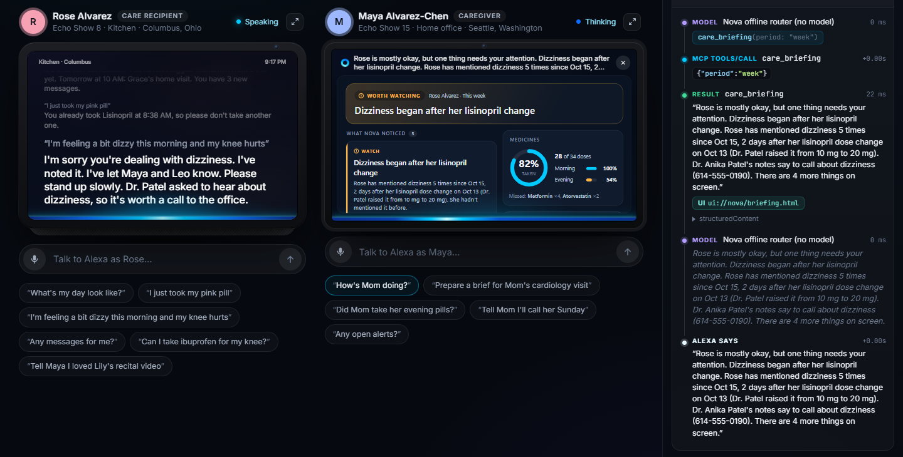
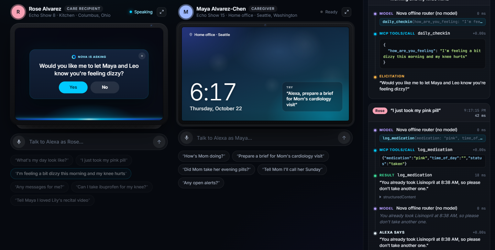
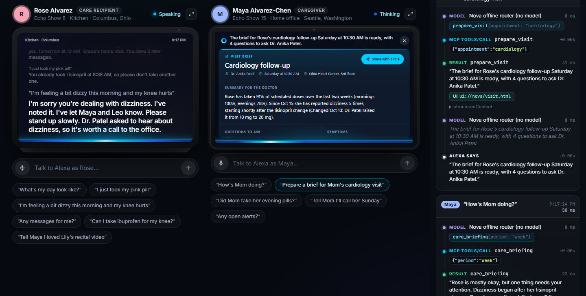
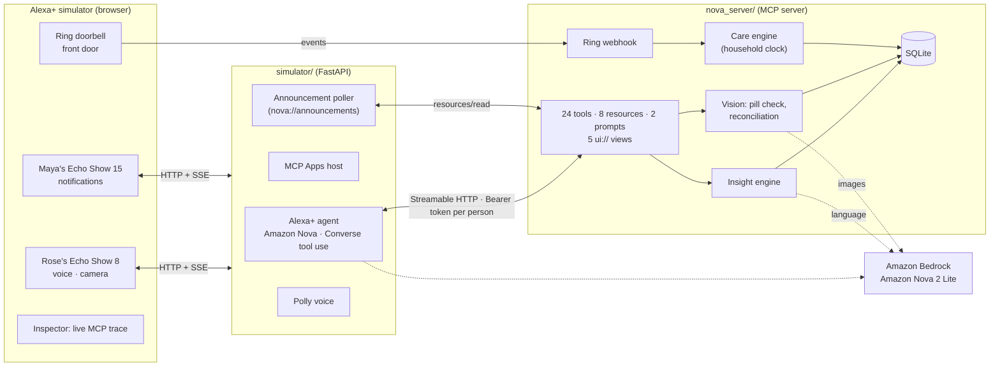

# Nova · a care circle for Alexa+

**Nova turns Alexa+ into a proactive, multimodal care circle for an older adult who lives alone, and for the family who worry about them.**

It doesn't wait to be asked. It reminds Rose when her pill is due, follows up, and only then tells her daughter. It reads pill bottles and the doctor's paperwork with Amazon Nova. It notices when the front door hasn't opened all morning, and it connects small signals into the one insight that matters: *"her dizziness started two days after the blood pressure dose was doubled."*

Nova is a self-hosted **MCP server** (Streamable HTTP, MCP 2026-07-28, compatible with 2025-11-25), the integration path Alexa+ uses for third-party experiences. The repo also ships a **simulated Alexa+**: two Echo Shows and a Ring doorbell in the browser, with an agent that runs on **Amazon Nova models in Amazon Bedrock**.

> Track: **Alexa+** (self-hosted MCP server + simulated Alexa+ experience) · Mini challenge: **AWS Builder** (Amazon Bedrock with Amazon Nova, multimodal; Amazon Polly)



| Rose is asked before her family is told | A doctor-visit brief, one voice command away |
|---|---|
|  |  |

---

## Why

- More than 53 million Americans are unpaid family caregivers (AARP, *Caregiving in the U.S.*, 2020), many of them long-distance.
- About one in four adults 65+ falls each year (CDC).
- Medication changes at a doctor's visit or a hospital discharge are where mistakes happen: an old bottle in the cabinet, a new dose nobody wrote down.
- The early signals are small and scattered: a skipped evening pill, "I felt a bit woozy getting up", an aide's blood pressure reading, a quiet morning. Nobody sees them together until something goes wrong.

Voice is the right interface: no app to learn, no screen to unlock, and Alexa is already in the kitchen.

## Who would ship this
Nova is an integration a care brand hosts and Alexa+ calls, so it has natural owners:
- **Home-care agencies** (Grace's employer) offer Nova to clients' families: aides see the plan and log visits, and families get the briefing and escalations.
- **Medicare Advantage and Part D plans** are scored on medication adherence for diabetes drugs, RAS antagonists (such as lisinopril) and statins: Rose's exact three prescriptions. Reminders, the escalation ladder and refill nudges move those numbers.
- **Pharmacies** use the refill flow and the reconciliation after a visit, which is where dose errors happen.
- **Families directly**, through Alexa+ account linking, with the older adult in control of what's shared.

## What Nova does

### 1. It speaks first: the proactive care engine
A care engine runs on the household clock and turns the care plan into **announcements** on the right device:

| When | Nova |
|---|---|
| 6:00 PM, dose due | Rose's Echo: *"It's 6 PM, Rose. Time for your Metformin with your meal. That's the large white oblong pill."* (quick replies: *I took it* · *Remind me in 10 minutes* · *I'll skip it tonight*) |
| 6:30 PM, still not taken | *"Just checking, Rose: have you taken your 6 PM Metformin yet?"* |
| 7:30 PM, still not taken | Maya's Echo glows yellow: *"Mom hasn't taken her 6 PM Metformin. I reminded her at 6 PM and 6:30 PM."* An alert opens. |
| 9:00 AM, no check-in yet | *"Good morning, Rose! How are you feeling today?"* |
| 11:00 AM, a quiet home | No pills logged, no movement at the door: *"Is everything okay?"* At 11:30 with no answer, the family gets an **urgent** notification. |
| Evening before an appointment | *"Tomorrow at 10:30 you see Dr. Patel. Leo is driving you. Want me to get your visit brief ready?"* |
| After the visit | *"Dr. Patel asked for a blood pressure reading every morning before your pills."* |

Messages between family members arrive the same way, live, on the other person's Echo. A **time-lapse clock** plays a whole day in a minute for the demo.

### 2. It sees: Amazon Nova multimodal
- **"Is this the right pill?"** Rose holds a bottle up to the Echo Show camera. Nova reads the label and checks it against her plan:
  - Right pill, right time: *take one now.*
  - Wrong time: *"That's atorvastatin, your bedtime pill. Put it back. Right now it's time for…"*
  - Already taken: *please don't take another.*
  - Not on her list, or an outdated strength: *"This bottle is lisinopril 20 mg, but your plan now says 10 mg."*
  - Something her doctor said to avoid: *"Please don't take ibuprofen, Rose. Your knee discharge instructions say to avoid it because of blood pressure and kidney function. The same notes say: for pain, acetaminophen up to 3,000 mg a day."*
- **Medication reconciliation from paperwork.** Maya photographs the after-visit summary. Nova extracts the medication list and reconciles it with the current plan as *change / start / stop / continue*, with the doctor's reasons. Nothing changes until Maya taps **Approve**. Then Rose's plan updates, the instructions become a care note, and Rose hears in plain words what changed.

### 3. It connects the dots, with evidence
*"How's Mom doing?"* gives a spoken briefing plus an on-screen card:
> *Dizziness began after her lisinopril change.* Home BP averaged 152/91 before the change and 108/66 since. Rose has mentioned dizziness 4 times since Oct 15. Grace saw her unsteady. Dr. Patel's notes say to call about dizziness (614-555-0190).

It also tracks evening doses slipping while mornings hold, mood, pain and sleep trends, and *"she's stopped her walks"*. Every insight comes from deterministic, testable rules and carries its evidence. Amazon Nova only writes the language.

### 4. It listens to the front door: Ring (simulated)
Front-door events arrive through a webhook and become care signals:
- *Grace arrived at Mom's at 10:02*, logged as a visit and announced to the family.
- *The front door opened at 2:14 AM*: an urgent notification (night wandering).
- No movement all morning feeds the wellness check.

### 5. It stays safe and respectful
- **Double-dose guard**: *"You already took Lisinopril at 8:14 AM, so please don't take another one."*
- **Grounded answers**: *"Can I take ibuprofen for my knee?"* is answered only from the doctor's notes, with the source.
- **Consent first**: *"Would you like me to let Maya and Leo know you're feeling dizzy?"* (MCP elicitation). Emergencies skip the question.
- **Rose is in charge**: she decides what the circle sees (`set_sharing`); only she can change it.
- **Blood pressure by voice**, checked against the limits Dr. Patel wrote.
- **Refills before they run out**: Nova counts pills, nudges at 10 AM when a bottle has five days left, sends the refill to the pharmacy, and says when it's ready and who can pick it up.
- **Doctor-visit brief** with adherence, symptoms with first-seen dates, and questions to ask.

## Architecture



Sequence diagrams for a voice turn, the escalation ladder, consent by elicitation, photo-to-plan reconciliation and OAuth account linking are in [docs/ARCHITECTURE.md](docs/ARCHITECTURE.md).

| Layer | What it is |
|---|---|
| `nova_server/` | The Alexa+ integration: an MCP server on the official Python SDK (`mcp` 2.3). Streamable HTTP at `/mcp`, plus the care engine thread, vision and the Ring webhook. |
| `simulator/` | A simulated Alexa+: two Echo devices and a Ring doorbell, each Echo with its own MCP session and bearer token, an Amazon Nova tool-use agent, an MCP Apps host, live announcement delivery, a time-lapse clock and a protocol inspector. |
| `samples/` | Demo photos (three prescription bottles, an over-the-counter ibuprofen bottle, an after-visit summary) and their generator. All names are fictional. |
| `skills/nova-care/` | An Agent Skill that teaches any agent how to run Nova conversations well. |

### MCP features used
- **Streamable HTTP**; negotiates **2026-07-28** and serves **2025-11-25** clients (what Alexa+ speaks today; verified with an `initialize` against the Docker image).
- **Account linking with OAuth 2.1**: protected-resource metadata (RFC 9728), authorization-server metadata (RFC 8414), dynamic client registration (RFC 7591), PKCE, refresh-token rotation and revocation. The `/link` page is where a person says who they are in the circle (Login with Amazon or Cognito in production). Identity comes from the token, so the same tool answers differently for Rose and Maya. Demo bearer tokens still work for the simulator.
- **Structured output** with an `outputSchema` on every tool; each result carries a `speech` line written for TTS.
- **Tool annotations** and **icons**.
- **MCP Apps** (`io.modelcontextprotocol/ui`): five `ui://` views (today, briefing, visit brief, pill check, reconciliation) that render on the Echo Show screens and call tools back through the host. Camera-only tools use `_meta.ui.visibility: ["app"]` so the model never sees them.
- **Elicitation** for consent through SDK resolvers: an `InputRequiredResult` round trip on 2026-07-28, or `elicitation/create` on 2025-11-25.
- **Resources as a delivery queue**: `nova://announcements` is how Nova speaks first (on Alexa+ this maps to proactive notifications), alongside `nova://circle` and `nova://timeline`. **Prompts**: `morning_checkin`, `caregiver_briefing`.

### How Amazon Nova is used (AWS Builder)
- **Simulated Alexa+ brain** (`simulator/agent.py`): the tool-use loop on the **Bedrock Converse API** with Amazon Nova (default `*.amazon.nova-2-lite-v1:0`, region-aware, falling back to Nova Lite and Micro).
- **Vision** (`nova_server/vision.py`, `llm.vision_json`): Amazon Nova reads pill-bottle labels and after-visit summaries (Converse image blocks). The reconciliation after it is deterministic.
- **Language** (`nova_server/insights.py`): the spoken caregiver briefing, structured extraction from free-form check-ins, answers grounded only in the care notes, and doctor-visit briefs.
- **Amazon Polly** (generative voice) speaks replies and announcements.
- Request shapes are validated against the botocore API model in tests (`tests/test_bedrock_shape.py`).
- **Graceful degradation:** without AWS, Nova falls back to a local Ollama model (`qwen3:8b`, and `qwen3-vl` for vision), then to deterministic rules and sample-photo fixtures. The demo never breaks.

## Run it

Requires Python 3.12+ and [uv](https://docs.astral.sh/uv/).

```bash
git clone https://github.com/Dakshhhhh-ops/nova && cd nova
uv sync
cp .env.example .env        # AWS_REGION, NOVA_LLM, NOVA_MODEL_ID (optional)

# one command: MCP server + simulator, opens the browser (picks free ports if 8765/8080 are taken)
uv run python run.py

# or separately
uv run python -m nova_server      # http://127.0.0.1:8765/mcp
uv run python -m simulator        # http://127.0.0.1:8080
```

Open the simulator in Chrome (for the microphone and camera). Try:
1. **Reset demo**, then jump the clock to **5:55 PM** at **300×** and watch the reminder ladder reach Maya.
2. Rose: **Show Alexa** → a sample bottle (or your webcam).
3. Maya: **Scan paperwork** → the after-visit summary → **Approve**. Then Rose shows the old lisinopril bottle.
4. Ring: **Grace arrives**.

**Which brain?** `NOVA_LLM=auto` (default) uses Amazon Bedrock when your AWS credentials work; otherwise a local Ollama model; otherwise a deterministic offline router. The active brain is shown in the top bar. `NOVA_CLOCK=08:20` starts the household clock at a given time.

### Connect other MCP clients
- **MCP Inspector**: `npx @modelcontextprotocol/inspector`, URL `http://127.0.0.1:8765/mcp`. Either run its OAuth flow (it registers itself and opens Nova's account-linking page), or set the header `Authorization: Bearer nova-demo-maya` (or `nova-demo-rose`, `nova-demo-leo`, `nova-demo-grace`).
- **stdio** (Claude Desktop, Kiro, Claude Code): `uv run python -m nova_server --stdio --as rose`.
- **Docker**: `docker build -t nova-mcp . && docker run -p 8765:8765 -e NOVA_PUBLIC_URL=https://your.host nova-mcp`.

### Record the demo video
```bash
uv run --with playwright --with imageio-ffmpeg --with boto3 python scripts/record_demo.py --url http://127.0.0.1:8080
```
It drives the story in real Chrome, captures Alexa's spoken replies, adds an Amazon Polly narrator, and writes `demo/nova-demo.mp4` (under 3 minutes).

### Tests
```bash
uv run pytest -q
```
41 tests cover:
- the escalation ladder (and that taking the dose stops it), snooze, time jumps, check-in and wellness prompts;
- Ring events, live message delivery;
- pill checks (wrong time, already taken, outdated strength, a drug the doctor said to avoid), reconciliation and approval;
- BP limits read from the doctor's notes, the dizziness insight with its BP evidence;
- privacy, grounded answers, red flags, Bedrock request shapes;
- a real Streamable HTTP round trip with bearer auth and a consent elicitation;
- the full OAuth account-linking flow (discovery, registration, PKCE, linking, token exchange, single-use codes, refresh rotation);
- the simulator's HTTP API (chat with cards, camera, Ring, clock, notifications, reset) against a real MCP server.

## Tools

| Tool | Who | What |
|---|---|---|
| `get_today` (UI) | both | Today's doses (taken/due/missed/upcoming), appointments, unread messages |
| `log_medication` | both | Log by name, purpose or appearance; double-dose guard |
| `check_medication` | both | "Did I take…", "what's the pink pill for?" |
| `daily_checkin` | Rose | Free-form check-in → structured signals, red flags, consent |
| `log_vitals` | both | Blood pressure by voice, checked against the doctor's limits |
| `list_appointments` / `get_vitals` | both | "When is my doctor appointment?" (who's driving, where); "What's Mom's blood pressure?" (last reading, average, doctor's range) |
| `request_refill` | both | Refill to the pharmacy, with pickup plan; pill supply is tracked automatically |
| `send_message` / `read_messages` | both | Circle messaging, delivered live as announcements |
| `read_notifications` / `snooze_reminder` | both | "What are my notifications?", "Remind me in 10 minutes" |
| `ask_care_notes` | both | Grounded answers from doctors' notes, with sources |
| `get_help` | Rose | Alert the whole circle now |
| `care_briefing` (UI) | family | Status, adherence, BP and mood trends, insights with evidence, alerts |
| `prepare_visit` (UI) | both | Doctor-visit brief with questions to ask |
| `recent_activity` | family | Front door (Ring), doses and check-ins over the last hours |
| `check_pill_photo` (UI, camera) | Rose | Amazon Nova reads the bottle; right pill, right time, right strength? |
| `read_care_document` (UI, camera) | family | Amazon Nova reads the paperwork; reconciliation proposal |
| `apply_care_changes` | family | Approve or discard the proposed changes |
| `list_alerts` / `resolve_alert` | family | Open alerts, mark handled |
| `set_sharing` | Rose | Privacy: what the circle can see |
| `acknowledge_notification` (app only) | both | Device screens acknowledge announcements |

## Safety and privacy
- **No diagnosis, no new medical advice.** Medication and symptom answers come from the care team's own notes, with sources. Plan changes need a person's approval.
- **The older adult is in charge.** Consent before sharing symptoms; per-category sharing only she can change.
- **Emergencies are not gated.** Falls, chest pain, breathing trouble and stroke signs alert everyone and tell her to call 911.
- **Identity comes from the token**, never from what someone says. The Ring webhook is protected by a shared secret.
- The household, names, pharmacy and hospital in the demo are fictional.

## Roadmap
- Production account linking (Login with Amazon or Amazon Cognito) and deployment on Amazon Bedrock AgentCore Runtime.
- Real Ring events through the Ring developer APIs, and Alexa proactive notifications for announcements.
- Amazon Nova Sonic for full-duplex voice; Fire TV ambient cards in the living room.

## License
MIT. See [LICENSE](LICENSE).
