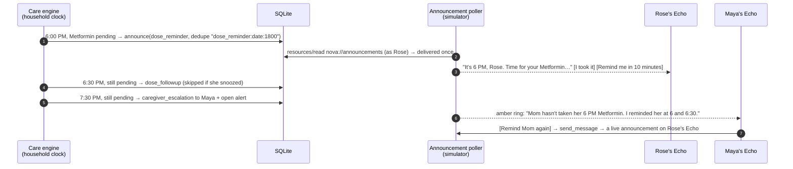
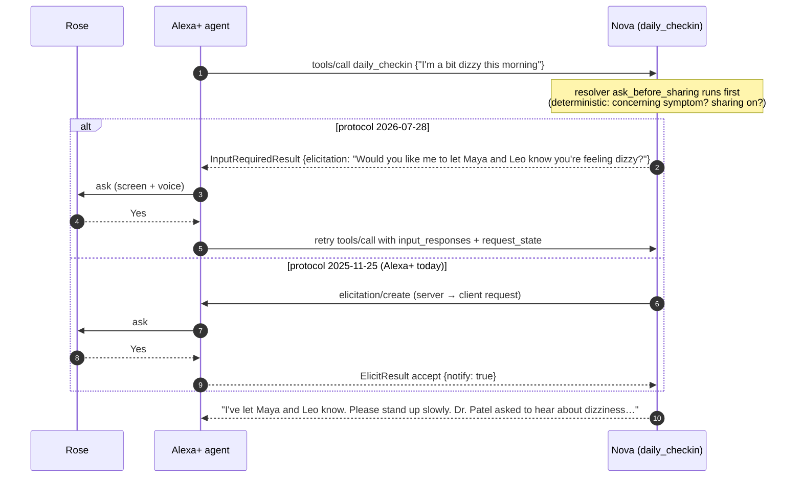
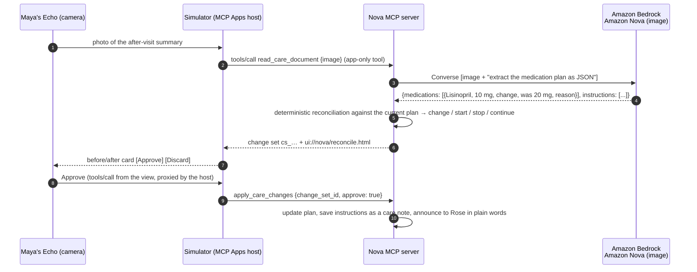
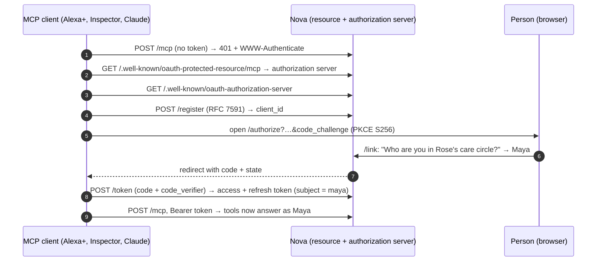

# Nova architecture

Nova is two processes and a browser:

| Process | What it is | Talks to |
|---|---|---|
| `nova_server` (port 8765) | The Alexa+ integration: an MCP server (Streamable HTTP at `/mcp`), its OAuth 2.1 authorization server, the care engine thread, vision, and the Ring webhook. SQLite holds the household. | Amazon Bedrock (Amazon Nova) for language and vision |
| `simulator` (port 8080) | A stand-in for Alexa+: one MCP client session per Echo (each with that person's token), the Amazon Nova tool-use agent, the MCP Apps host, the announcement poller, and Amazon Polly voice. | `nova_server` over MCP; Bedrock; Polly; the browser over HTTP + SSE |
| Browser | The story page (`/`) and the live demo (`/live`): Echo Shows, the Ring doorbell, the 3D stage, and the protocol inspector. | `simulator` |

Everything Alexa+ would do is behind the MCP boundary. A real Alexa+ deployment replaces the simulator: Alexa+ links the account (OAuth), calls the same tools, renders the same `ui://` views, and receives announcements as proactive notifications.

## 1. A voice turn
```mermaid
sequenceDiagram
  autonumber
  participant R as Rose (Echo Show 8)
  participant A as Alexa+ agent<br/>(Amazon Nova, Converse)
  participant N as Nova MCP server
  participant DB as SQLite
  R->>A: "I just took my pink pill"
  A->>A: choose a tool (model-visible tools only)
  A->>N: tools/call log_medication {medication: "pink"}<br/>Authorization: Bearer (Rose)
  N->>DB: today's doses for Rose; match "pink" to the small pink oval pill
  DB-->>N: Lisinopril 8 AM already taken at 8:14
  N-->>A: structuredContent {speech: "You already took Lisinopril at 8:14 AM, so please don't take another one.", warning: "double_dose_risk"}
  A->>R: speak (Polly) + screen
```
Every tool returns a `speech` line written for TTS, plus structured data for screens. The agent sees a compact version of large results (`for_model`). A voice guard falls back to `speech` if the model replies with markdown or an essay.

## 2. Nova speaks first: the escalation ladder

Triggers fire when the household clock crosses them, are idempotent (unique dedupe keys), and a big jump of the clock skips past them instead of replaying the day. The same engine sends the 9 AM check-in, the 11 AM quiet-home wellness check (escalating to the family at 11:30), appointment reminders, the morning BP prompt after the visit, refill nudges and "refill ready", and the Sunday family digest.

## 3. Consent before sharing (MCP elicitation)

The consent parameter is injected by the SDK (`Resolve(...)`) and never appears in the model-visible input schema. Red flags (a fall, chest pain) skip the question and alert everyone.

## 4. A photo becomes a plan change (Amazon Nova multimodal)

Pill bottles go through the same path (`check_pill_photo`): on her list? due now? already taken? an outdated strength? something the doctor said to avoid? Without AWS, the bundled sample photos resolve from fixtures and other photos go to a local vision model.

## 5. Account linking (OAuth 2.1)

In production the `/link` step is Login with Amazon or Amazon Cognito. Codes are single use, refresh tokens rotate, and tokens can be revoked. The demo tokens (`nova-demo-rose`, …) still work for the simulator.

## 6. The front door (Ring Partner API: pull and push)
```mermaid
sequenceDiagram
  autonumber
  participant R as Ring (Partner API)
  participant N as Nova /integrations/ring/webhook
  participant E as Care engine
  participant G as Grace (aide)
  participant M as Maya's Echo Show
  R->>N: POST Webhook v1.1 {meta.request_id, data.type: "button_press", attributes.timestamp}<br/>X-Signature: sha256=HMAC(raw body)
  N->>N: verify HMAC before parsing (401 if wrong: Ring won't retry a 4xx)
  N->>N: seen this request_id? → 200 {duplicate}
  N->>E: ding at 9:58 — who? Ring doesn't say → calendar: Grace's visit at 10:00
  E-->>G: "For today's visit: she hasn't logged her 8 AM pills; check her BP sitting and standing; Metformin is running low."
  E-->>M: "Grace arrived at Mom's at 9:58."
  N-->>R: 200 (well within Ring's 5 s)
```
**Pull, too.** `nova_server/ring_api.py` calls the Ring Partner API every 5 minutes, when a caregiver asks about recent activity, and on "Sync from Ring": `GET /v1/users/me` → `GET /v1/devices` → `GET /v1/devices/{id}/status` → `GET /v1/history/devices/{id}/events?event_types=ding,motion.human` (following `links.next`). New events become the same signals as webhooks. Fresh ones (under 10 minutes) are announced; older ones go on the timeline quietly. Ring's event ids are stored, so nothing is imported twice. A `503` from the status endpoint means the device is offline, which is a care signal too.

`motion_detected` (with `attributes.sub_type`, e.g. `human`) feeds the "quiet home" wellness check; `device_offline` lands on the timeline. The simulator signs its events with the same HMAC, so the demo exercises the real verification path. A night-time `door_open` comes from a contact sensor, not Ring, and uses the simple shared-secret endpoint (`/integrations/ring/events`).

## Design choices
- **Deterministic signals, model language.** Patterns (a symptom after a dose change, evening doses slipping, a quiet home) come from rules that are testable and cite evidence. Amazon Nova writes the spoken briefing, extracts check-ins, answers from the notes and reads images. Every model call has a template or fixture fallback.
- **Identity from the token, never from speech.** The same tool answers differently for Rose and Maya; only Rose can change what's shared.
- **Voice first, screen second.** `speech` for the ear (one or two sentences, then "Want the details?" with the rest in `more`), `structuredContent` + `ui://` views for the Echo Show. When a tool returns `speech`, the agent speaks it without a second model call: one Converse round trip per turn instead of two.
- **Fail fast, degrade gracefully.** A throttled Bedrock call falls back for that turn; a dropped MCP connection reconnects and retries; without WebGL the demo renders in 2D.
